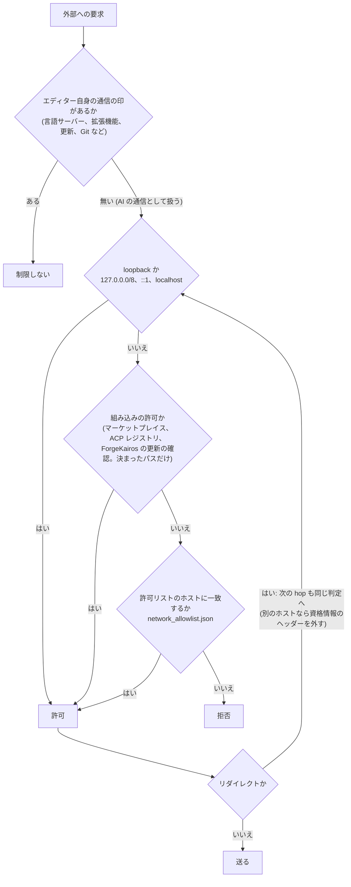
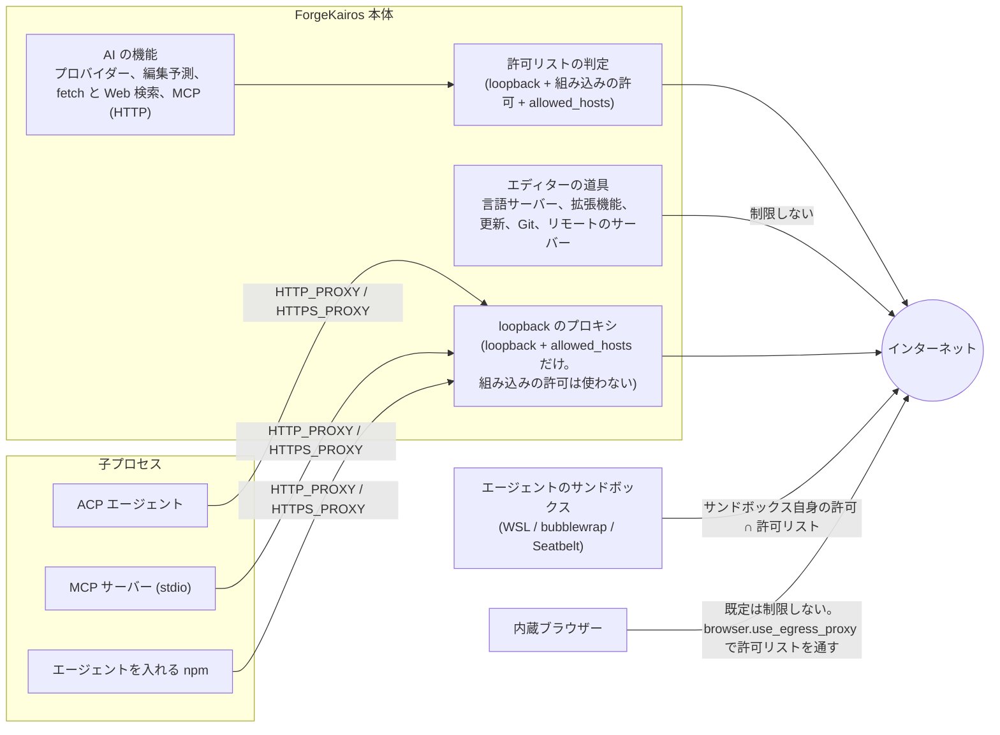
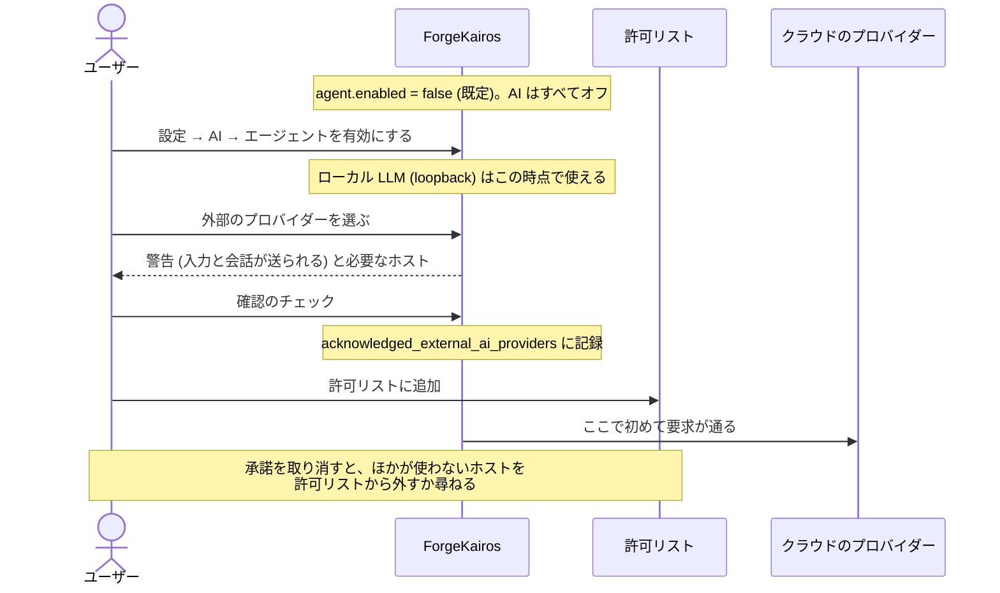
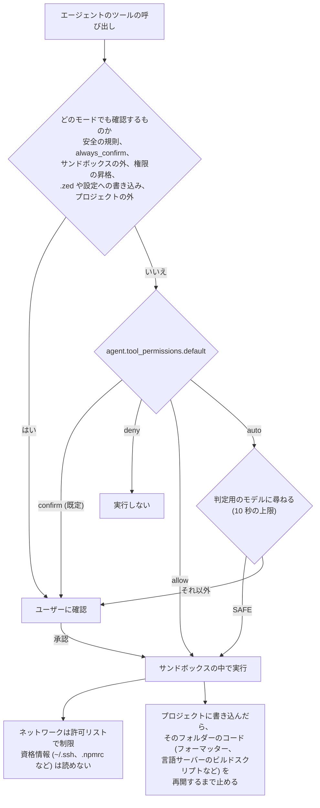
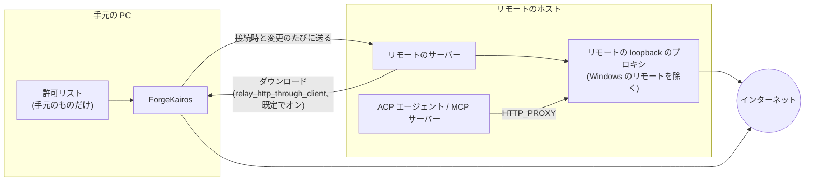

# AI と通信の制限の全体図

[English](../overview.md)

ForgeKairos の AI と外部通信の制限を図で示す。細かい規則は [外部通信の統制](network.md) と [AI](ai.md) を見る。

## 1 つの要求が通るか

AI の機能が始める HTTP の要求は、次の順に判定する。

- 許可リストが空でも loopback は通るので、ローカル LLM (Ollama、LM Studio、llama.cpp) は設定なしで使える。
- ホストを許可すると、そのホストのすべてのポートを許可する。

## 誰がどの経路で制限されるか

- 子プロセスのプロキシは、プログラムがプロキシの環境変数を読むことに頼る。読まないプログラムは制限できない。
  `proxy_child_processes: false` で切れる。
- サンドボックスは許可リストを狭めることはできるが、広げることはできない。

## クラウドの AI を使い始めるまで

既定ではどの AI も動かず、外部のプロバイダーには何も送らない。

承諾しても許可リストに足さなければ、そのプロバイダーへの通信は拒否のまま。

## エージェントがコマンドやツールを実行するとき

- `auto` はコマンドとパスを判定用のモデルのプロバイダーに送るので、ローカルのモデルを勧める。
- サンドボックスを切れるのは `agent.sandbox_permissions.allow_unsandboxed` だけで、切っている間はすべてのコマンドで確認する。

## SSH のリモート

インターネットに出られないリモートでも、手元の PC 経由で言語サーバーを取ってこられる。
