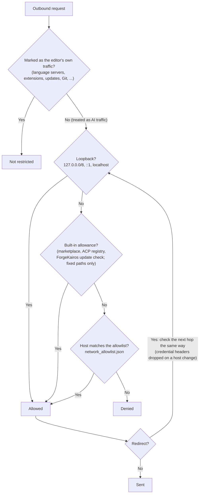
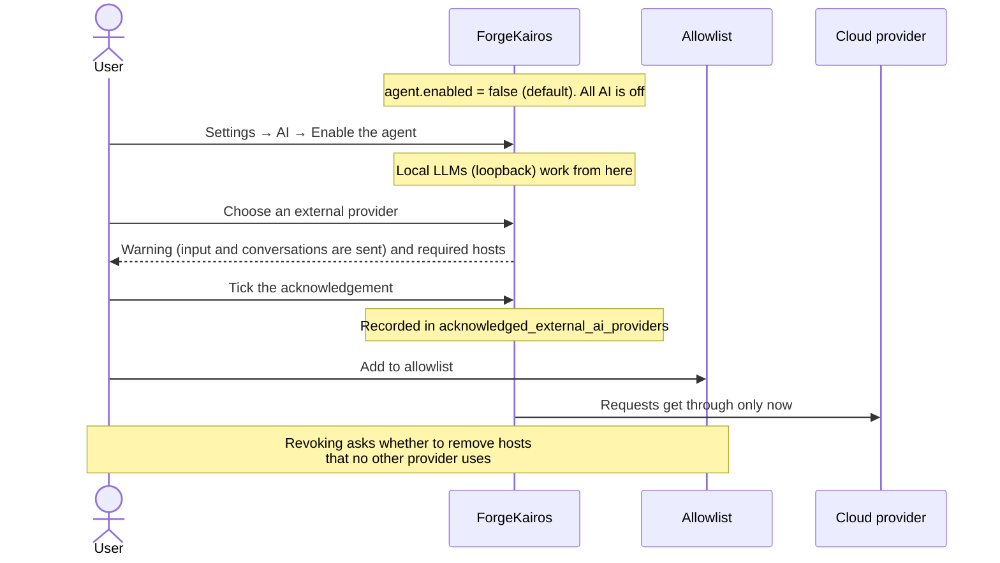
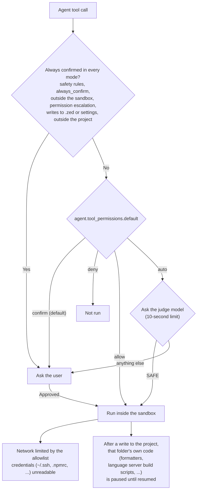
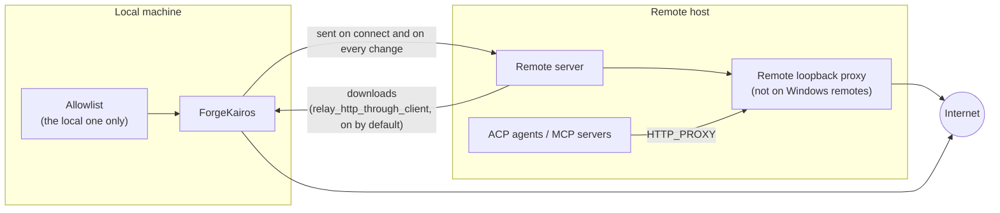

# AI and network restrictions at a glance

[日本語](ja/overview.md)

These diagrams show how ForgeKairos restricts AI and outbound network traffic. For the detailed rules, see
[Outbound network control](network.md) and [AI](ai.md).

## Is a request let through?

An HTTP request started by an AI feature is checked in this order.

- Loopback is let through even with an empty allowlist, so local LLMs (Ollama, LM Studio, llama.cpp) work
  without any setup.
- Allowing a host allows every port on it.

## Who is restricted, and through which path

```mermaid
flowchart LR
    subgraph APP["ForgeKairos"]
        AI["AI features<br/>providers, edit predictions,<br/>fetch and web search, MCP (HTTP)"]
        TOOLS["Editor tools<br/>language servers, extensions,<br/>updates, Git, remote server"]
        GATE["Allowlist check<br/>(loopback + built-in allowances + allowed_hosts)"]
        PROXY["Loopback proxy<br/>(loopback + allowed_hosts only;<br/>no built-in allowances)"]
    end
    subgraph CHILD["Child processes"]
        ACP["ACP agents"]
        MCP["MCP servers (stdio)"]
        NPM["npm installing agents"]
    end
    SB["Agent sandbox<br/>(WSL / bubblewrap / Seatbelt)"]
    BR["Built-in browser"]
    NET(("Internet"))

    AI --> GATE --> NET
    TOOLS -- "not restricted" --> NET
    ACP & MCP & NPM -- "HTTP_PROXY / HTTPS_PROXY" --> PROXY --> NET
    SB -- "sandbox's own allowances ∩ allowlist" --> NET
    BR -- "not restricted by default;<br/>browser.use_egress_proxy routes it through the allowlist" --> NET
```

- The child-process proxy relies on the program reading the proxy environment variables. A program that
  ignores them cannot be restricted. Turn it off with `proxy_child_processes: false`.
- The sandbox can narrow the allowlist but never widen it.

## Before a cloud AI provider is used

By default no AI runs, and nothing is sent to an external provider.

Acknowledging without adding the hosts leaves traffic to that provider denied.

## When the agent runs a command or tool

- `auto` sends the command and paths to the judge model's provider, so a local model is recommended.
- The only way to turn the sandbox off is `agent.sandbox_permissions.allow_unsandboxed`, and while it is
  off every command is confirmed.

## SSH remotes

A remote with no internet access can still fetch language servers through the local machine.
